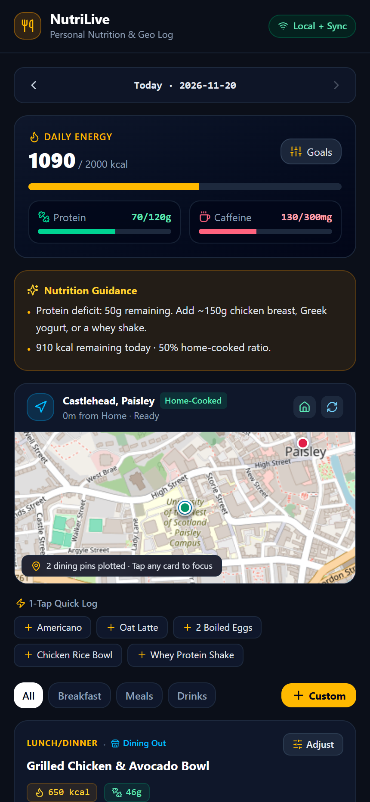

# NutriLive — Real-Time Meal & Nutrition PWA

A mobile-first, installable Progressive Web App for low-friction meal logging, live
nutrition summaries, GPS-based dining context and on-device meal photos. Built with
React 18 and Vite, fully usable offline, and persisted entirely on the device.

COMP10013 Dynamic Web Technologies — Coursework 01 (Part A report + Part B demonstration).



- Live app: <https://nutrilive.vercel.app>
- Source repository: <https://github.com/jiuye050712-png/nutrilive>

---

## 1. What the app does

| Feature | Where it lives | Module topic it demonstrates |
|---|---|---|
| Full CRUD on meal records | `src/App.jsx`, `src/components/LiveMealCard.jsx` | React state, controlled inputs |
| Live macro totals (calories, protein, caffeine) | `src/App.jsx` | Derived state, `useMemo` |
| On-device persistence across reloads | `src/db/db.js` (Dexie.js / IndexedDB) | On-device storage |
| GPS dining context (Home-Cooked vs Dining Out) | `src/hooks/useGeolocation.js` | Device API — Geolocation |
| Meal photo capture | `src/components/MealCamera.jsx` | Device API — MediaDevices / camera |
| Interactive location map | `src/components/MealMap.jsx` (Leaflet) | Geolocation visualisation |
| Installable, offline-first shell | `public/manifest.json`, `public/sw.js` | PWA — manifest + service worker |
| One-tap quick logging | `src/App.jsx` | Reusable presets and event handling |
| CI build on every push | `.github/workflows/ci.yml` | DevOps |

## 2. Tech stack

| Layer | Choice | Why |
|---|---|---|
| UI | React 18 (function components + hooks) | Module content; hooks give small, reusable units |
| Build tool | Vite 6 | Fast dev server and small production bundles |
| Styling | Tailwind CSS 4 | Utility-first, mobile-first responsive layout |
| Icons | lucide-react | Consistent tree-shaken vector icons |
| Storage | Dexie.js over IndexedDB | Asynchronous structured records, supports photos |
| Map | Leaflet | Lightweight open-source interactive maps |
| Camera | react-webcam | React wrapper for `getUserMedia` |
| PWA | Web app manifest + custom service worker | Installability and offline app shell |
| CI | GitHub Actions | Build verification on every push |

## 3. Project structure

```
nutrilive/
├── .github/
│   └── workflows/ci.yml       # install -> build -> verify PWA assets
├── public/
│   ├── manifest.json          # PWA metadata, theme colour and icons
│   ├── sw.js                  # App shell cache and offline fetch handling
│   ├── icon.svg               # Vector fork icon
│   ├── icon-192.png           # 192x192 install icon
│   ├── icon-512.png           # 512x512 install icon
│   └── icon-maskable-512.png  # Maskable icon
├── src/
│   ├── main.jsx               # React root and service worker registration
│   ├── index.css              # Tailwind and global styles
│   ├── App.jsx                # Main container: state, totals, forms, presets
│   ├── db/
│   │   └── db.js              # Dexie schema, goals and seed data
│   ├── hooks/
│   │   └── useGeolocation.js  # watchPosition, Haversine distance, context
│   └── components/
│       ├── LiveMealCard.jsx   # Inline update and delete
│       ├── MealCamera.jsx     # Camera capture and upload fallback
│       └── MealMap.jsx        # Leaflet map and dining pins
├── docs/
│   ├── shots/                 # figures used in the report
│   └── lighthouse-report.html # full Lighthouse audit
├── tools/                     # icon and screenshot helper scripts
├── index.html
├── vite.config.js
└── package.json
```

## 4. Getting started

### Prerequisites

- Node.js 18 or newer (developed and verified on Node 22) and npm 9+
- A modern browser: Chrome / Edge 111+, Safari 16.4+, Firefox 115+

### Install and run

```bash
# 1. Clone the repository
git clone https://github.com/jiuye050712-png/nutrilive.git
cd nutrilive

# 2. Install dependencies
npm install

# 3. Start the dev server (http://localhost:5173)
npm run dev
```

### Production build and preview

```bash
npm run build     # outputs a static bundle to dist/
npm run preview   # serves dist/ at http://localhost:4173
```

The build includes `manifest.json`, `sw.js` and the icons, which make the output an
installable PWA. The service worker registers on a production build rather than in the
dev server.

## 5. Install it as an app

1. Open the deployed HTTPS URL (or `npm run preview`).
2. In Chrome / Edge, use the install icon in the address bar, or the browser menu and
   **Install NutriLive**.
3. Launch it from the home screen; it opens in standalone mode without browser chrome.
4. With the network set to offline, the cached app shell still launches and the stored
   meals remain available.

## 6. User guide

| Task | Steps |
|---|---|
| Quick log a meal | Tap a **1-Tap Quick Log** chip (e.g. Americano, Oat Latte) to add it instantly |
| Add a custom meal | Tap **+ Custom**, enter the name, type, calories, protein, caffeine and note, then **Save Entry** |
| Read and browse | View the daily energy dashboard and the list of meal cards for the selected date |
| Update a meal | Tap **Adjust**, then edit the title, type, sliders or note; changes save without a separate Save step |
| Delete a meal | Tap **Adjust**, then **Delete** |
| Take a meal photo | Tap **Adjust**, then **Camera**, capture the photo and attach it; use **Upload** if the camera is blocked |
| Check dining context | Move more than 60 m from the home anchor and the context switches to **Dining Out** |
| Set the home anchor | On the map, tap the home icon to save the current location as the kitchen |
| Change daily goals | Tap **Goals**, choose a preset or edit the calorie, protein and caffeine targets |

## 7. Device API notes

- **Geolocation** — `watchPosition()` runs inside `useEffect`, so location updates do not
  block the interface. The Haversine formula calculates the distance from a saved home
  anchor; displacement greater than 60 m is tagged Dining Out, otherwise Home-Cooked.
- **Camera** — `react-webcam` wraps `getUserMedia` and requests the rear camera with
  `facingMode: environment`. Captured images are compressed and stored on the device. A
  file input with `capture="environment"` provides a mobile fallback.
- Both APIs require a secure context (HTTPS or localhost).

## 8. Data model

```json
{
  "id": 1,
  "dateKey": "2026-11-20",
  "title": "Grilled Chicken & Avocado Bowl",
  "mealType": "Lunch/Dinner",
  "calories": 650,
  "protein": 46,
  "caffeine": 0,
  "note": "High-protein lunch bowl with brown rice and sesame dressing.",
  "diningContext": "Dining Out",
  "lat": 55.8458,
  "lon": -4.4241,
  "placeName": "High Street, Paisley",
  "photo": null,
  "updatedAt": 1732100000000
}
```

The Dexie database (`NutriLiveDB_v3`) contains a `meals` store and a `goals` store.
Default goals and two sample meals are seeded on first launch.

## 9. DevOps and CI

The pipeline stays small enough to verify on a laptop.

| Stage | What happens | Evidence |
|---|---|---|
| Build | `npm ci` then `npm run build` | Fresh clone builds reproducibly: JS 449.70 kB (gzip 138.32 kB), CSS 48.22 kB (gzip 12.78 kB) |
| CI | `.github/workflows/ci.yml` on every push: checkout → Node 20 → `npm ci` → `npm run build` → verify `dist/` contains the manifest and service worker | green GitHub Actions run for `main` |
| Verify | manual checklist (section 11) on `npm run preview` | screenshots in `docs/shots/` |
| Release | Vercel deploys the production build | live site at <https://nutrilive.vercel.app> |

### Lighthouse audit (mobile, production build)

| Category | Score |
|---|---|
| Performance | 95 |
| Accessibility | 74 |
| Best Practices | 96 |
| SEO | 83 |

Core metrics: First Contentful Paint 1.7 s, Largest Contentful Paint 2.8 s, Total Blocking
Time 0 ms, Cumulative Layout Shift 0.023, Speed Index 1.7 s. The full report is at
[`docs/lighthouse-report.html`](docs/lighthouse-report.html).

## 10. Deployment

Any static host works (Vercel, Netlify, Cloudflare Pages, GitHub Pages). HTTPS is required
for the Geolocation and camera APIs, with localhost as the only exception.

```bash
npm run build
# Deploy the dist/ folder to your chosen static host
```

## 11. Manual test checklist

| # | Step | Expected |
|---|---|---|
| 1 | Open the app | Daily dashboard with progress ring, guidance, map and quick log |
| 2 | Tap a Quick Log chip | Meal appears and totals update immediately |
| 3 | Add a custom meal and save | New card listed with the entered values |
| 4 | Open Adjust, edit sliders, close | Inline changes persist without a separate Save step |
| 5 | Delete a meal | Card disappears and totals recalculate |
| 6 | Reload the page | All entries remain (Dexie / IndexedDB) |
| 7 | Simulate displacement over 60 m | Context switches to Dining Out and the distance is shown |
| 8 | Open Camera and capture | Photo is attached; Upload works if the camera is blocked |
| 9 | Switch to offline | Offline Mode badge shows; app shell and stored meals still load |
| 10 | Build, preview, Application tab | Manifest, icons, standalone display and active service worker |

## 12. Troubleshooting

| Problem | Cause / fix |
|---|---|
| Camera never starts | Site not HTTPS (or not localhost), permission denied, or another app holds the camera |
| GPS does not update | Location permission blocked, or the browser cannot get a position; check site settings |
| Nothing loads offline | The service worker only registers on a production build/preview, not in `npm run dev` |
| No install prompt | Already installed, browser unsupported, or the manifest/service worker is missing |
| Data missing after reload | Private/incognito mode or cleared site data; storage is per browser and origin |

## 13. Roadmap

1. Automated unit and end-to-end tests (Vitest and Playwright).
2. Background sync and push notifications via Web Push.
3. Barcode scanning for faster entry.
4. Shared household mode through a backend API.
5. Long-term nutrition trends and analytics.

## 14. References

- Dexie.js (2025) *Dexie.js Documentation*. <https://dexie.org/docs/>
- MDN Web Docs (2025) *Geolocation API*. <https://developer.mozilla.org/en-US/docs/Web/API/Geolocation_API>
- MDN Web Docs (2025) *MediaDevices: getUserMedia()*. <https://developer.mozilla.org/en-US/docs/Web/API/MediaDevices/getUserMedia>
- MDN Web Docs (2025) *Web App Manifests*. <https://developer.mozilla.org/en-US/docs/Web/Manifest>
- React (2025) *React Reference*. <https://react.dev/reference/react>
- Leaflet (2025) *Leaflet Documentation*. <https://leafletjs.com/reference.html>
- Vercel (2025) *Vercel Documentation*. <https://vercel.com/docs>

## 15. Statement of AI use

Generative AI was used as an assistant during part of this work. The application's core
source code — the React components, custom hooks, the Dexie data layer and the
geolocation, camera and map integrations — was written by the author. AI was used to:

- draft the web app manifest and service worker, and the application icons;
- draft and structure this README;
- help produce the presentation slides and automate the screenshots, which are captured
  from genuine runs of the application and a real Lighthouse audit.

The author reviewed, adapted and verified every generated item and takes full
responsibility for the final content and correctness. No fabricated results, metrics or
references are included.
